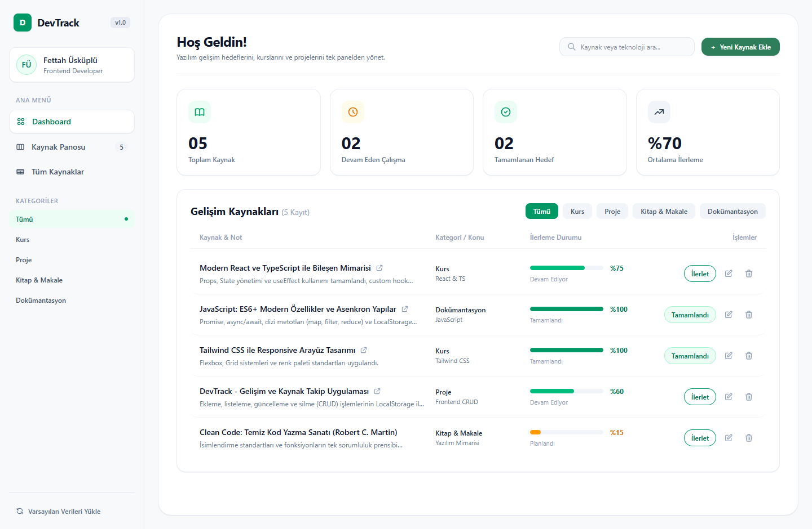
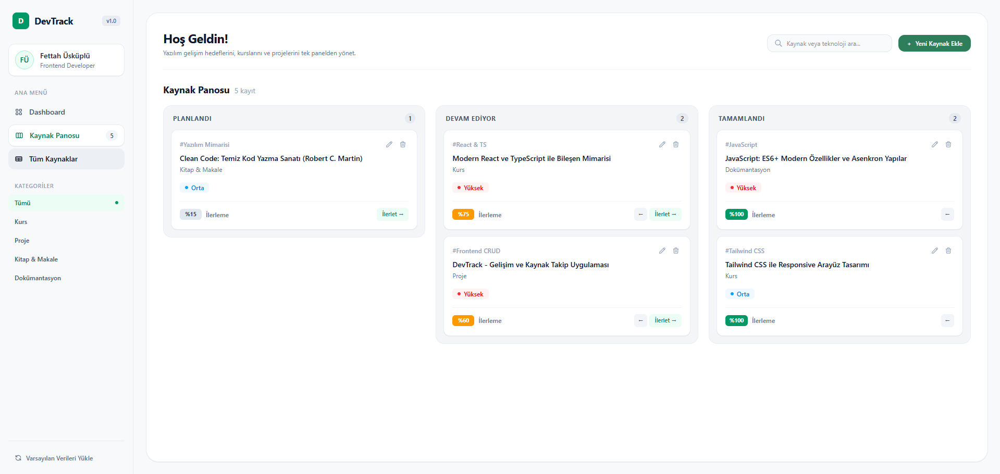
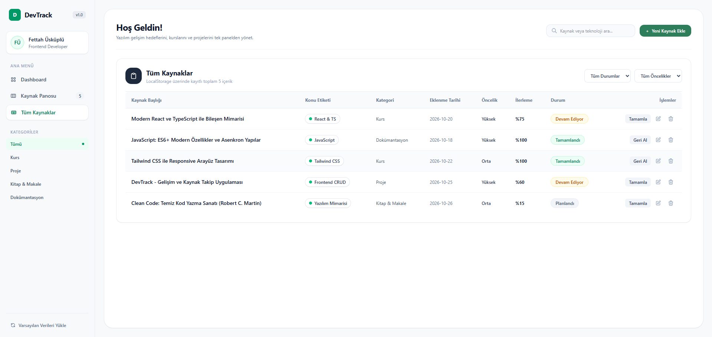

# DevTrack — Yazılımcı Gelişim ve Kaynak Takip Uygulaması

React, TypeScript ve Tailwind CSS kullanılarak geliştirilmiş; yazılım öğrenim sürecindeki kurs, kitap/makale, dokümantasyon ve projeleri takip etmeyi sağlayan web uygulaması.

## Özellikler

- **Kaynak Yönetimi (CRUD):** Yeni gelişim kaynağı ekleme, mevcut kayıtları düzenleme, hızlı durum güncelleme ve silme işlemleri.
- **3 Farklı Görünüm Modu:**
  - **Dashboard:** Genel istatistik kartları, ilerleme durumu ve kategori bazlı hızlı liste görünümü.
  - **Kaynak Panosu (Kanban Board):** *Planlandı*, *Devam Ediyor* ve *Tamamlandı* aşamalarına göre sütunlu kart görünümü.
  - **Tüm Kaynaklar (Tablo):** Durum ve öncelik filtreli detaylı tablo görünümü.
- **Arama ve Filtreleme:** Başlık, konu etiketi, kategori, durum ve öncelik seviyesine göre anlık filtreleme.
- **Veri Kalıcılığı (LocalStorage):** Tüm veriler tarayıcı hafızasında (`LocalStorage`) saklanır, sayfa yenilendiğinde kaybolmaz. İstenildiğinde varsayılan başlangıç verilerine sıfırlanabilir.

## Kullanılan Teknolojiler

- **React 19** & **TypeScript**
- **Vite**
- **Tailwind CSS v4**
- **LocalStorage API**

## Proje Klasör Yapısı

```text
src/
├── components/
│   ├── Sidebar.tsx         # Sol menü ve kategori filtreleme paneli
│   ├── DashboardView.tsx   # İstatistik kartları ve ana liste görünümü
│   ├── BoardView.tsx       # 3 sütunlu Kanban pano görünümü
│   ├── TableView.tsx       # Filtrelenebilir tablo görünümü
│   └── ResourceModal.tsx   # Kaynak ekleme ve düzenleme formu (Modal)
├── interfaces/
│   └── resource.ts         # TypeScript veri modelleri ve tipler
├── pages/
│   └── HomePage.tsx        # Ana sayfa ve CRUD state yönetimi
├── utils/
│   └── storage.ts          # LocalStorage okuma/yazma ve başlangıç verileri
├── App.tsx
└── main.tsx
```

## Ekran Görüntüleri

### 1. Dashboard Görünümü


### 2. Kaynak Panosu (Kanban Board) Görünümü


### 3. Tüm Kaynaklar (Tablo) Görünümü


## Kurulum ve Çalıştırma

Projeyi yerel ortamınızda çalıştırmak için:

```bash
# Bağımlılıkları yükleyin
npm install

# Geliştirme sunucusunu başlatın
npm run dev

# Production derlemesi oluşturun
npm run build
```
